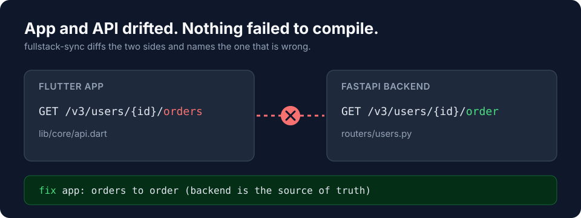

# fullstack-sync

[](https://github.com/Eugen24/fullstack-sync/actions/workflows/test.yml)
[](https://github.com/Eugen24/fullstack-sync/releases)
[](LICENSE)


**A Claude Code plugin that stops your app and your API from drifting apart.**



Keep a client app and its backend API in lockstep. Catches the exact class of
bug where the app calls an endpoint the backend doesn't expose (or vice-versa),
field names drift, or a method/path disagrees — and fixes the named side.

Stack-agnostic; tuned for **Flutter + FastAPI** (the layout it was built
against) but detects Node/Django/Go/Rails on the backend and Flutter/RN/web on
the client.

## Why

The classic full-stack bug: the app calls `/v3/users/{id}/orders`, the backend serves
`/v3/users/{id}/order`. Types compile, tests pass, and it 404s in production.
fullstack-sync diffs the app's endpoint constants and services against the backend's
routes and schemas, names the side that is wrong, and fixes it. Nothing runs and no
tokens are spent until a contract file actually changes.

## Install

```
claude plugin marketplace add Eugen24/fullstack-sync
claude plugin install fullstack-sync@neo-plugins
```

(Or, for local dev, point the marketplace at a local clone path instead of the
GitHub slug.)

## First run

From inside the **app** repo:

```
/fullstack-setup
```

It asks for the backend path + any extra folders, scans both repos for
OpenAPI / markdown route docs / endpoint constants, and writes
`.fullstack-sync.json` at the app root. Then `/add-dir <backend-root>` so both
repos are first-class in the session.

## Skills (model-invoked — just ask)

| Skill | Use it for |
|-------|-----------|
| `api-contract-sync` | "check API contracts", endpoint mismatch, 404/405 from app, after changing a route — diffs app constants/services ↔ backend routes/schemas and fixes the drift |
| `fullstack-feature` | "add this endpoint on backend and app" — scaffolds route+schema AND constant+service+model with identical field names |
| `fullstack-run` | "run backend and app together" — boots the API, health-checks it, points the app at local |
| `fullstack-verify` | "verify before commit" — app analyze + backend tests + migration drift + contract recheck |
| `parallel-sync-status` | two-session parallel mode — "am I in sync", "did the backend change", report contract drift between the backend and app sessions (report-only; fixes go through `api-contract-sync`) |

## Config: `.fullstack-sync.json`

Lives at the app repo root, written by `/fullstack-setup`, read by every skill.
Records app/backend roots + stacks, the endpoints file, router/schema globs, the
doc/spec files to treat as contract truth, and version base-paths.

## Parallel mode (two sessions)

For building a feature with one session per side at the same time:

1. `/fullstack-parallel-init` — creates `.fullstack-sync/`, auto-detects shared-file
   ownership, prints the `git worktree` commands.
2. Open one `claude` session per worktree (backend / app).
3. Each session: `parallel-sync-status` to check drift, `fullstack-feature` to build its
   side. Drift is caught by comparing a structural contract fingerprint — no event log,
   no locks, no orchestrator. See `references/parallel-sync.md`. Once both sides agree, `/fullstack-reconcile`
   (run from the app session) records the reconcile point so later drift is detected.

## Sync levels (safe by default)

`sync_level` in `.fullstack-sync.json` controls the post-change nudge. **Default `low`** —
the plugin asks for your dirs, then stays quiet until a contract file actually changes; it
spends no tokens and touches no code or commits unless you accept the nudge.

| Level | Behaviour |
|-------|-----------|
| `off` | silent, fully manual |
| `low` *(default)* | drift-gated Stop hook prints a one-line "contract moved — review?" suggestion; you decide. `/fullstack-sync-review` runs a scoped, lens-selected, report-only review |
| `hard` | `/fullstack-sync-review --hard` (or the hook in hard mode) reviews both repos across all lenses and can auto-sync + commit — **only on a feature branch; it refuses on master/main** |

FastAPI backends get a precise fingerprint gate (nudges only when the contract hash truly
moves, and stays quiet on comment-only edits to a route file). Other stacks get a coarser
"contract files changed" gate until more extractors exist — it can't confirm the hash
moved, so it re-nudges each turn a contract file shows as changed, until you act. See
`docs/superpowers/specs/2026-06-30-sync-level-review-design.md`.

## CI drift gate (no Claude, no tokens)

`scripts/drift_check.py` checks the contract on every run: **paths, HTTP methods and JSON field names**.

```
python3 scripts/drift_check.py                       # PATH + METHOD, uses ./.fullstack-sync.json
python3 scripts/drift_check.py --fields              # + FIELD? review list (report only)
python3 scripts/drift_check.py --strict-fields       # FIELD? findings fail the run too
python3 scripts/drift_check.py --openapi spec.json   # backend from an OpenAPI file
python3 scripts/drift_check.py --json --warn         # machine output, never fails
```

| Finding | Meaning | Fails the run |
|---|---|---|
| `PATH` | the app calls a path no backend route serves | yes |
| `METHOD` | the path exists, but not with the verb the app uses (`.get/.post/...`) | yes |
| `FIELD?` | a key the app reads in `fromJson` or writes in `toJson` that no backend model declares | only with `--strict-fields` |

Exit `0` clean, `1` drift, `2` bad input. The Stop hook runs the same check and puts the concrete
`PATH`/`METHOD` lines in its nudge, so what you see is always against the current code.

What it can and cannot see, honestly:
- Paths and verbs come from string literals inside HTTP calls (UI routes like `context.go('/home')` are
  ignored); `app.endpoints_file` counts every literal. A base URL or `include_router` prefix present on
  only one side is tolerated, so it can miss a drift but should not invent one.
- `FIELD?` compares the app's keys (snake_case-normalised, so `createdAt` equals `created_at`) with the
  union of all backend model fields. It catches renames and typos, not a field that exists on a *different*
  model, and it is a review list: a key may be client-only or the backend may return a plain dict.
  If most keys are unknown the extractor cannot see that backend's models, so it says so and skips instead
  of printing noise. Per-endpoint field checking stays with the `api-contract-sync` skill.
- Dynamic paths (`'$base/v4/$path'`) are not seen. Opt out of a call with `// fss-ignore`, or list paths in
  `"drift_ignore": ["/v4/remo/{id}"]` in `.fullstack-sync.json`.

A ready workflow is in `docs/examples/drift-gate.yml`.

## Testing

```
bash tests/run.sh
```

Runs the whole suite (python3 + git, no other deps): `fingerprint` unit tests
(determinism + camel/snake normalization), `sync_state` unit tests (slice write,
single-writer reconcile, drift status), and an end-to-end `test_protocol.sh` that drives
two real git repos through init → slice → reconcile → drift via the `sync_state` CLI. Runs
in CI on every push/PR (`.github/workflows/test.yml`). The mechanical state ops live in the
tested `scripts/sync_state.py`; the model only does contract *extraction*.

## Changelog

See [CHANGELOG.md](CHANGELOG.md). Latest: **v0.5.0**, the drift check now covers HTTP methods and field names. v0.4.0 added the CI gate; v0.3.1 made the Stop hook about 10x faster.

## Contributing

Issues and PRs welcome. Run `bash tests/run.sh` (python3 + git only) before opening a PR.

## Why it exists

Real drift caught on day one of dogfooding: the app called an endpoint whose
path didn't match the backend's, and several URL constants were missing or
pointed at routes that didn't exist — each a silent runtime 404 the analyzer
couldn't see. This plugin makes that visible before it ships.
